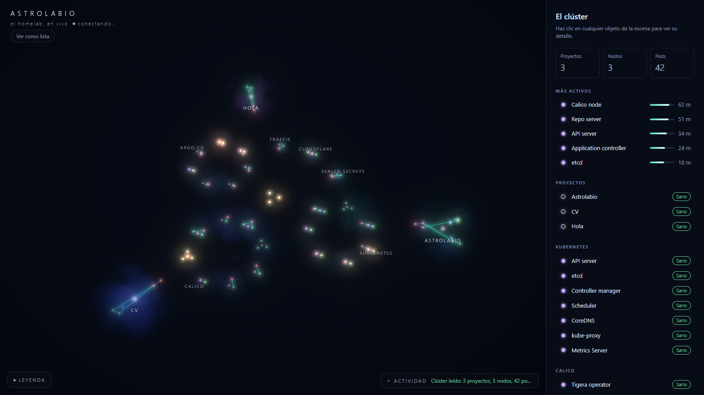

# Astrolabio

**Mi homelab de Kubernetes, en vivo, como una galaxia en 3D.**
👉 [astrolabio.fabiancienfuegos.com](https://astrolabio.fabiancienfuegos.com)



Astrolabio lee el clúster en tiempo real y dibuja cada objeto de Kubernetes como una
estrella: proyectos, Deployments, ReplicaSets, pods, Services y rutas públicas, más la
infraestructura que los sostiene (Kubernetes, Calico, Argo CD, Traefik, Cloudflare y
Sealed Secrets) y los tres nodos del clúster. Cuando algo cambia (un despliegue, un pod
que se reinicia, una réplica que se cae) la escena se mueve sola, sin recargar.

## Qué se ve

- **Cada objeto es una estrella.** Su forma y su color dicen qué es (disco: pod o
  workload, anillo: proyecto o ReplicaSet, rombo: Service, triángulo: ruta pública).
- **La posición dice de quién es.** Los pods giran alrededor de su ReplicaSet, junto a su
  workload, alrededor del anillo de su proyecto. Las líneas solo marcan relaciones reales:
  un Service y los pods que selecciona, una ruta y sus Services.
- **La CPU calienta la estrella.** Con [metrics-server](https://github.com/kubernetes-sigs/metrics-server),
  lo que trabaja crece, brilla y se vuelve ámbar; lo que está en reposo queda frío y tenue.
- **Al centro, la infraestructura**: cada sistema de la plataforma es su propio cúmulo,
  alrededor de los tres nodos (control plane, worker 1 y worker 2).
- **A la derecha, el detalle** de lo que selecciones (salud, réplicas, CPU, commit, estado
  en Argo CD) y, abajo, un **registro de actividad** en vivo. También hay una **vista de
  lista** accesible con el mismo contenido.

## Cómo funciona

```
Kubernetes API ─► astrolabio-api ─────────────────────────► navegador
 (list + watch)    · informers en memoria (sin base de datos)   · React + Three.js
                   · arma una galaxia sanitizada                · GET /api/galaxy al cargar
                   · GET /api/galaxy  y  WebSocket /ws ────────► · /ws empuja cada cambio
metrics-server ──► · CPU y memoria cada 15 s
```

- **API** (`api/`): Python 3.13, FastAPI y `kubernetes_asyncio`, todo en un solo event loop.
  Un *informer* por recurso hace `list` una vez, guarda en memoria y sigue con `watch`
  (con re-list ante `410 Gone`). Cada cambio se convierte en la galaxia completa, que pasa
  por un contrato de Pydantic con lista blanca de campos y se envía por WebSocket.
- **Web** (`web/`): Vite, React y TypeScript para la interfaz; la escena es Three.js
  directo con shaders propios (estrellas, nebulosas con ruido fbm, bloom). Las
  transiciones nunca saltan, ni siquiera con `prefers-reduced-motion`.
- **Contrato** (`contract/`): el esquema JSON se genera desde los modelos de la API y la
  web genera sus tipos de TypeScript desde él.

## Seguridad (el sitio es público)

Defensa en capas, de afuera hacia adentro:

- **Cloudflare**: el clúster no abre puertos; todo entra por un Cloudflare Tunnel, con
  rate limiting en `/api` y `/ws`, HTTPS forzado y HSTS.
- **Nada crudo sale de la API.** Cada objeto se convierte a un modelo con lista blanca de
  campos (`extra="forbid"`). Nunca se publican variables de entorno, volúmenes, IPs,
  hostnames de los nodos, versiones ni tags de la plataforma, ni el repo privado de
  GitOps. Una prueba con un "clúster envenenado" y otra sobre la foto real del clúster
  lo verifican.
- **Solo lectura de punta a punta**: la API solo acepta GET; el RBAC lista cada recurso
  sin comodines (sin secrets ni configmaps); el WebSocket descarta lo que mande el
  cliente, solo acepta el origen del sitio y limita conexiones por visitante.
- **Pods mínimos**: sin root, raíz de solo lectura, sin capabilities, PSA `restricted`;
  solo la API monta token de ServiceAccount; NetworkPolicies con *default deny* (la API
  solo sale al API server y al DNS).
- **Cadena de suministro**: dependencias fijadas por hash (`uv.lock`, `package-lock.json`),
  imágenes base fijadas por digest, Trivy en cada build y Dependabot.

## Despliegue

GitOps, igual que el resto del homelab: un push a `main` corre lint, tests, build, Trivy y
publica la imagen en `ghcr.io/fabiancienc/astrolabio-*`; el CI actualiza el tag en el
repo de GitOps y Argo CD lo despliega. Los manifiestos de Kubernetes viven en ese repo,
no aquí.

## Desarrollo

```
# API (desde api/)
uv sync && uv run pytest
ASTROLABIO_ENV=development ASTROLABIO_SOURCE=example uv run uvicorn astrolabio_api.main:app --reload

# Web (desde web/)
npm ci && npm run dev        # http://localhost:5173; sin API local usa la galaxia de ejemplo
```

Más detalle en [`api/README.md`](api/README.md) y [`web/README.md`](web/README.md). El
diseño completo está en [`astrolabio.md`](astrolabio.md) y el plan por etapas en
[`PLAN.md`](PLAN.md).

## Estado

Hecho: API en vivo, galaxia 3D, tiempo real por WebSocket y CPU con metrics-server.
Siguiente: líneas de tráfico con Prometheus (peticiones por ruta de Traefik como pulsos
de luz) y, después, detección de anomalías con un resumen escrito por un LLM.
